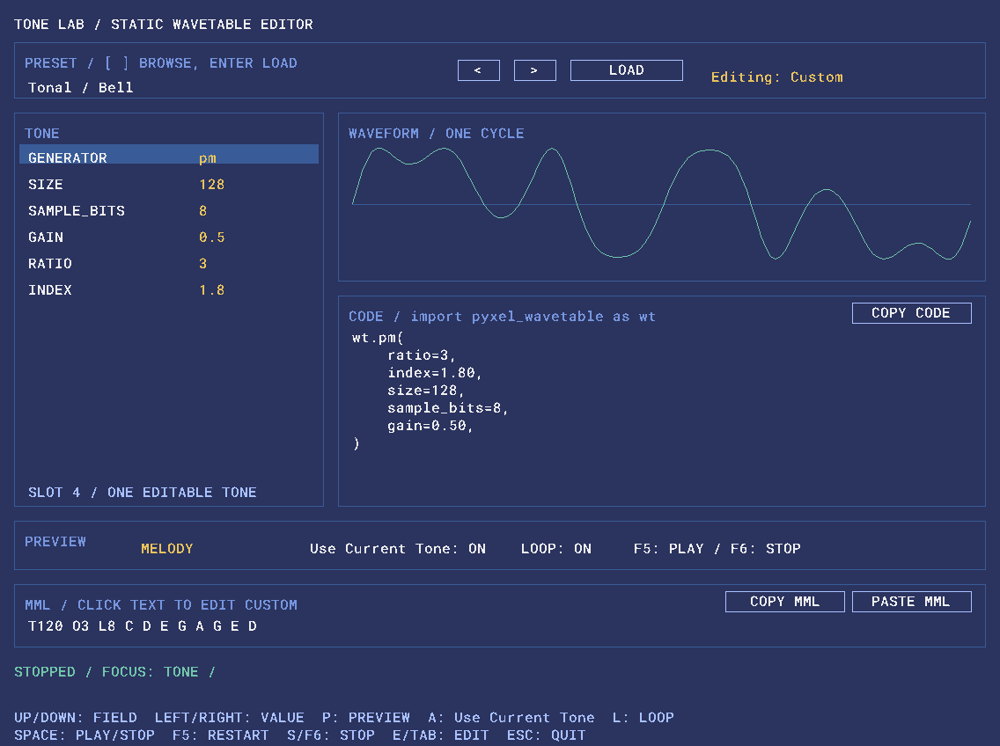
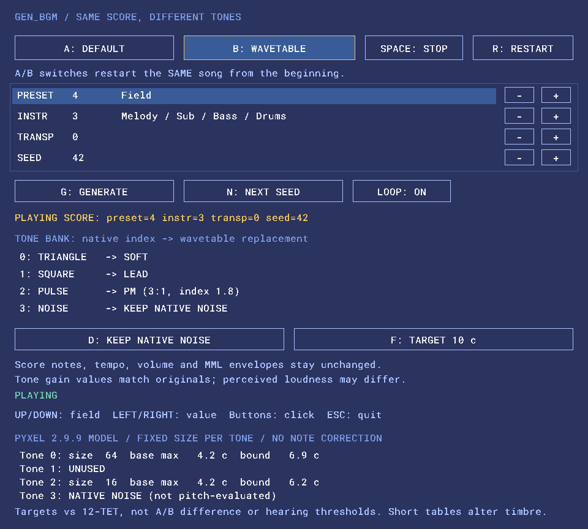

# pyxel-wavetable

[](https://github.com/daraddara/pyxel-wavetable/actions/workflows/tests.yml)

`pyxel-wavetable` は、数式・パラメータ・波形サンプルから通常の `pyxel.Tone` を生成する小さなPythonユーティリティです。

生成したToneはPyxel標準の `Sound` / `Music` / MML / `play()` / `playm()` からそのまま利用できます。Pyxel本体やRustコードは変更しません。

## Features

- Sine / Triangle / Saw / Square / Pulse
- 倍音合成 `harmonics()`
- 固定位相変調 `pm()`
- 任意関数・サンプル列からのTone生成
- Tone登録用 `add_tone()` / `add_tones()`
- 音作りの出発点になる10種類のPreset
- パラメータを調整しながら試聴できる Tone Lab
- 同じ楽曲で標準音とwavetable音を聴き比べる BGM Compare

## Requirements

- Python 3.11+
- Pyxel 2.9.9以上、3未満

## Install

ソースコードを取得し、利用するPython環境へインストールします。

```sh
python -m pip install .
```

開発・テストを行う場合:

```sh
python -m pip install -e ".[test]"
python -m pytest -q
```

## Quick start

```python
import pyxel
import pyxel_wavetable as wt

pyxel.init(160, 80, title="Wavetable demo")

tone_index = wt.add_tone(
    wt.pm(ratio=3, index=1.8)
)

pyxel.play(
    0,
    f"@{tone_index} T120 O3 L8 C D E G",
    loop=True,
)

def draw():
    pyxel.cls(1)
    pyxel.text(8, 8, "ESC: QUIT", 7)

pyxel.run(lambda: None, draw)
```

generatorは通常の `pyxel.Tone` を返します。再生・MML・Sound・Musicの管理はPyxel側に任せます。

## Tone generators

```python
wt.sine()
wt.triangle()
wt.saw()
wt.square()
wt.pulse(duty=0.25)
wt.harmonics([1.0, 0.5, 0.25, 0.1])
wt.pm(ratio=3, index=1.8)

import math
wt.from_function(lambda p: math.sin(p) + 0.3 * math.sin(2 * p))
wt.from_samples([0, 0.5, 1, 0.5, 0, -0.5, -1, -0.5])
```

共通の初期値は次の通りです。

```text
size=128
sample_bits=8
gain=0.5
```

`from_samples()` は入力サンプル数をそのままwavetable長として使うため、`size` は取りません。

## Presets

Presetは固定音色モードではなく、generatorの使い方を示す小さな静的音色例です。

### Tonal

```python
wt.bell()
wt.bass()
wt.lead()
wt.organ()
wt.soft()
```

### Percussion

```python
wt.tom()
wt.woodblock()
wt.cowbell()
wt.metallic()
wt.click()
```

パーカッション系Preset自身はEnvelopeやピッチ変化を持ちません。必要な減衰は通常のPyxel MML Envelopeなどと組み合わせます。

## Register tones

`add_tone()` / `add_tones()` は既存の `pyxel.tones` を置換せず、末尾へ追加してTone indexを返します。

```python
pm = wt.add_tone(wt.pm())

sine, saw, pulse = wt.add_tones([
    wt.sine(),
    wt.saw(),
    wt.pulse(0.125),
])
```

戻り値は通常の `int` / `tuple[int, ...]` です。

### MML

複数桁のTone indexもMMLならそのまま指定できます。

```python
pyxel.play(0, f"@{pm} O3 C D E G")
```

Pyxel 2.9.9の `Sound.set()` / `set_tones()` のTone文字列は1文字ずつ解釈されるため、`str(index)` で直接指定できるのは0〜9です。10以上ではMMLの `@<tone index>` を利用してください。

## Tone Lab



`examples/tone_lab.py` は、Presetやgeneratorのパラメータを調整しながらToneを試聴するためのインタラクティブなサンプルです。

```sh
python examples/tone_lab.py
```

主な用途:

- 全Presetを編集可能なパラメータとして読み込む
- PM / Harmonics / Pulseなどを調整する
- wavetableの形を確認する
- 既定Previewで試聴する
- 任意のMMLを入力・貼り付けして試す
- 現在のgenerator設定をPythonコードとしてコピーする

詳しい画面構成・操作方法・ショートカットは [Tone Lab Manual](docs/tone-lab.md) を参照してください。

## BGM Compare



`examples/bgm_compare.py` は、同じBGMをPyxel標準Toneとwavetable Toneで切り替えて聴き比べるサンプルです。

wavetableでは、長いsizeほど複雑な波形を表現しやすい一方、Pyxel 2.9.9の整数クロック丸めによるピッチ誤差が大きくなりやすいというトレードオフがあります。BGM Compareでは、実際の楽曲で使われる音域を調べ、次の3条件を切り替えて比較できます。

- **TARGET 10 c** — 予測ピッチ誤差の保守的な上限を10 cent以下に収めることを目標にsizeを選ぶ
- **TARGET 25 c** — 25 cent以下を目標に、より長いsizeとの音色差を比較する
- **FIXED SIZE 128** — `DEFAULT_SIZE=128` 相当の固定条件で比較する

10 / 25 centは「聞き取れない」「許容できる」ことを保証する閾値ではありません。ピッチ精度と波形・音色の再現性の妥協点を、数値と実際のBGMの両方で確認するための比較条件です。

```sh
python examples/bgm_compare.py
```

Tone Labが個々のToneや任意フレーズの調整・診断を行うのに対し、BGM Compareは複数パートを含む実際の楽曲で結果を確認する用途です。詳しい操作、size選択、表示値の意味は [BGM Compare Manual](docs/bgm-compare.md) を参照してください。

## Examples

```sh
python examples/basic_tones.py
python examples/melody_compare.py
python examples/custom_wave.py
python examples/percussion_presets.py
python examples/tone_lab.py
python examples/bgm_compare.py
```

- `basic_tones.py`: 基本generatorの音色比較
- `melody_compare.py`: Tonal Presetを同じメロディで比較
- `custom_wave.py`: 任意関数からToneを生成
- `percussion_presets.py`: パーカッションPreset + MML Envelope
- `tone_lab.py`: パラメータ編集・MML試聴・コード出力
- `bgm_compare.py`: 同じ曲を標準音／wavetable音で比較。10 cent・25 cent目標・128点固定を切り替えて、ピッチと音色の違いを試聴できます。操作と画面は [BGM Compare Manual](docs/bgm-compare.md) を参照してください。

## Notes and limitations

このライブラリは1周期の静的wavetable生成を対象とします。

- 動的PM Envelopeなし
- Note On/Off管理なし
- 独自シーケンサなし
- 独自Sound / Musicなし
- 毎フレームのwavetable更新なし
- アンチエイリアス・帯域制限・ピッチ補正なし

`pm()` の `ratio` は正の整数に限定しています。非整数比ではキャリア1周期内で波形が閉じず、繰り返し境界が不連続になる可能性があるためです。

`DEFAULT_SIZE=128`、`DEFAULT_SAMPLE_BITS=8`、`DEFAULT_GAIN=0.5` はこのプロジェクトの初期方針であり、Pyxel本体の推奨値ではありません。

Pyxel 2.9.9では、サンプルの再生時間が整数クロックへ丸められるため、wavetable長と音程によって実ピッチに誤差が生じます。高音・長いwavetableほど影響が大きくなりやすい一方、誤差の向きと大きさは音符ごとに変わります。`DEFAULT_SIZE=128` は当初の波形再現性・試聴結果を基に選んだ初期値であり、ピッチ精度の推奨値や保証値ではありません。

ピッチ精度が重要なら、実際に使う音域・楽曲で32 / 64 / 128点などを比較して選んでください。短いwavetableは一般にピッチ誤差を抑えやすい一方、複雑なPMや高次倍音を含む波形では再現性とのトレードオフがあります。ライブラリは自動ピッチ補正を行わず、用途に応じたsizeの選択を利用者へ委ねます。実測と選び方は [Wavetable長とピッチ誤差](docs/wavetable-pitch.md)、制約と残る検証課題は [技術課題](docs/technical-issues.md) を参照してください。

Tone LabのPitch Error表示では、指定音域に対するsize別の予測ピッチ誤差を、音を鳴らさず数値とグラフで確認できます。使い方は [Tone Lab Manual](docs/tone-lab.md#pitch-error音域ごとのピッチ誤差を確認する) を参照してください。

正規化・量子化・デフォルト値の背景・責務境界などの詳細は [Design](docs/design.md) を参照してください。

## License

MIT License

Tone Labに同梱するRoboto MonoはSIL Open Font License 1.1です。詳細は [examples/assets/fonts/README.md](examples/assets/fonts/README.md) を参照してください。

## Links

- [Pyxel](https://github.com/kitao/pyxel)
- [Pyxel API Reference](https://kitao.github.io/pyxel/web/api-reference/)
- [Tone Lab Manual](docs/tone-lab.md)
- [Design](docs/design.md)
