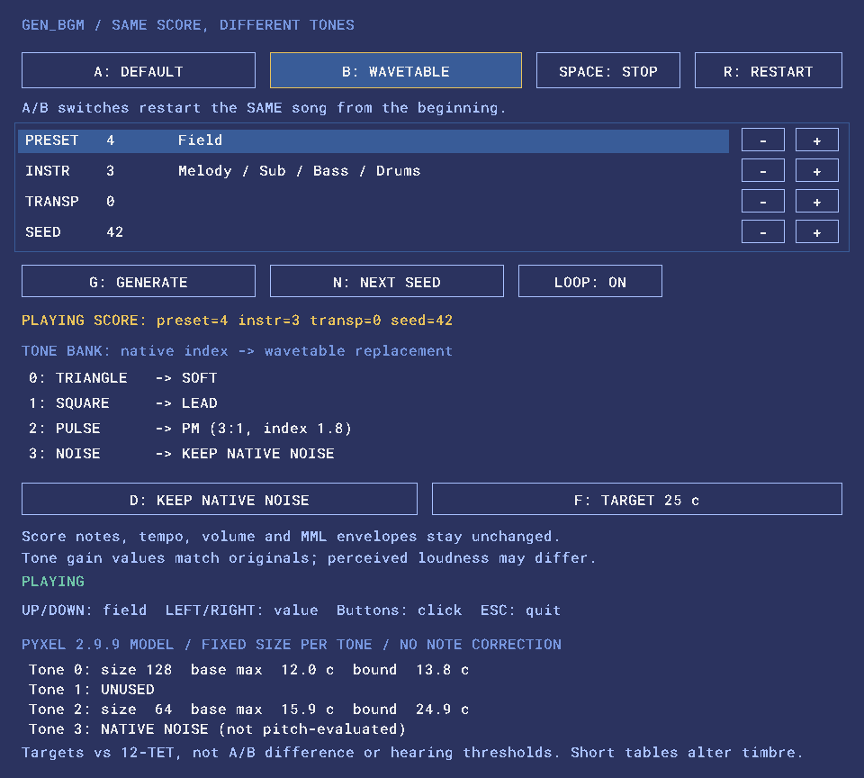
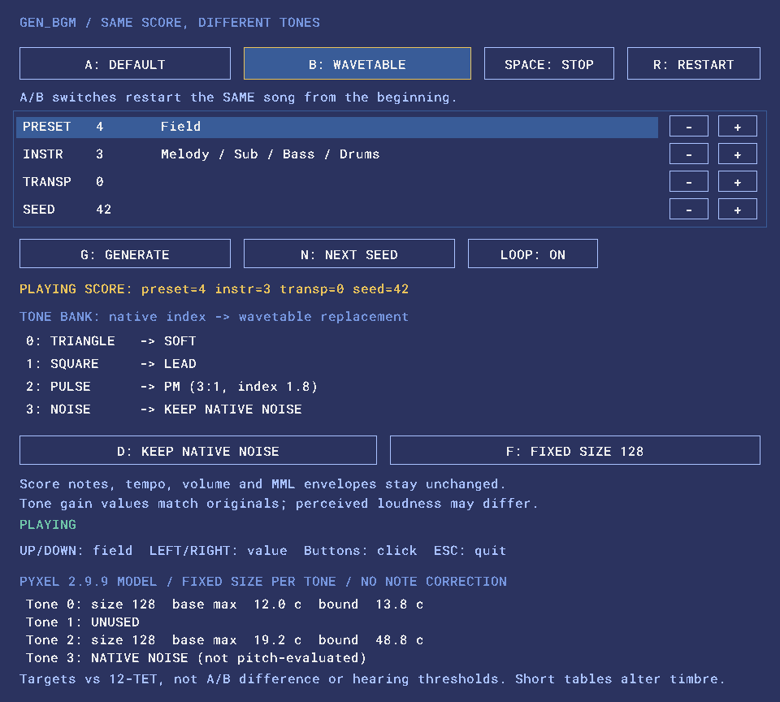

# BGM Compare Manual

BGM Compareは、Pyxelの `gen_bgm()` で生成した同じ曲を、標準Toneとwavetable Toneで聴き比べるサンプルです。曲の音符・テンポ・Envelope・Vibratoを保ったまま音色を切り替え、10 cent目標・25 cent目標・128点固定の違いも比較できます。

Tone Labが単音・フレーズでの音作りを中心とするのに対し、BGM Compareは複数パートが重なる実際の楽曲での比較に使います。実装は `examples/bgm_compare.py` と内部補助モジュール `examples/_bgm_pitch.py` にあり、ライブラリの公開APIではありません。

## 起動と最初の比較

[READMEのセットアップ](../README.md#install)に従ってPyxelと本ライブラリをインストールし、リポジトリのルートで実行します。

```sh
python examples/bgm_compare.py
```

1. 起動すると標準音（A: DEFAULT）でループ再生します。
2. **B: WAVETABLE**を押し、同じ曲をwavetable音で聴きます。
3. **A: DEFAULT**で標準音へ戻します。再生中の切替は毎回先頭から再生します。
4. **F: TARGET**で10 cent → 25 cent → 128点固定を切り替え、再度A/Bで比較します。
5. **SPACE**で再生・停止します。停止中の音色・目標変更は停止を維持します。

ボタンはマウスでも操作できます。起動時の曲はpreset=4 / transp=0 / instr=3 / seed=42、目標は10 centです。以下の画像はすべて、この曲をBで再生した実画面です。


画面上部は再生とA/B切替、その下は曲の生成条件です。中央のTONE BANKは音色の対応、下部は選んだsizeと予測ピッチ誤差を表示します。標準Noiseは初期状態で置き換えません。

## 10 cent・25 cent・128点固定を比較する

Fキー、または右側の目標ボタンを押すとモードが循環します。再生中は同じ曲を先頭から再生し直します。曲そのものは再生成しません。

| モード | 動作 |
| --- | --- |
| TARGET 10 c | 予測誤差の保守的な上限が10 cent以下になる固定sizeを選ぶ |
| TARGET 25 c | 同様に25 cent以下を目標とし、音色再現性との違いを比較する |
| FIXED SIZE 128 | すべての置換Toneを128点で生成し、従来の設定と比較する |

目標モードでは候補8 / 16 / 32 / 64 / 128 / 256 / 512点のうち、目標を満たす最も長いsizeをTone indexごとに選びます。同じToneを使うパートの音符はまとめて評価します。選択したsizeは曲全体で固定され、音符ごとのTone切替やdetuneは行いません。ライブラリの `DEFAULT_SIZE=128` も変更しません。

### 25 cent目標



この曲のPM（Tone 2）は、10 cent目標では16点、25 cent目標では64点になります。下部の `bound` は、それぞれ約6.2 centと24.9 centです。長い表で音色の再現性が変わる一方、許容するピッチ誤差の上限も変わることを聴き比べます。

### 128点固定



同じPMを128点固定にすると、`base max` は約19.2 cent、`bound` は約48.8 centになります。固定モードには10／25 centの目標制限がありません。

## 表示値の読み方

| 表示 | 意味 |
| --- | --- |
| size | 現在のwavetableモードに使うToneの固定点数 |
| base max | 曲で使う音符の基本周波数について、12平均律に対する最大絶対誤差 |
| bound | 最高音とVibrato幅を含めて見積もった、クロック量子化誤差の保守的な上限 |
| UNUSED | 曲で使われていないTone |
| NATIVE NOISE | 標準Noiseを維持。周期波形のピッチ評価対象外 |

値は **Pyxel 2.9.9の確認済み整数クロックモデルによる予測**で、録音・FFTによる実測ではありません。標準音（A）を選んでいる間も、表はBに切り替えた場合の設定を示します。

`bound` は全パートのVibrato定義の最大幅を全Toneへ適用するため、実際より厳しいsize選択になる場合があります。最高音での丸め後のクロック数をqとして、`-1200 × log2(1 - 0.5/q)` centで上限を見積もります。`base max` はVibratoを除いた音符での値なので、両者は一致しません。詳しい周波数モデルは[ピッチ調査](wavetable-pitch.md)を参照してください。

**10／25 centは「気にならない」ことを保証する閾値ではありません。** 目標は12平均律に対するクロック量子化誤差で、標準音とのA/B差そのものでもありません。標準Toneにも誤差があります。聴感上の音高・aliasing・倍音構成・音量は別の問題で、短い表では複雑なPMなどの音色が変わります。数値と実際の曲での試聴を合わせて判断してください。

## 操作一覧

| 操作 | キー |
| --- | --- |
| 標準Toneへ切替 | A |
| wavetable Toneへ切替 | B |
| 再生・停止 | SPACE |
| 選択したモードで先頭から再生 | R |
| ループ切替 | L |
| 標準Noiseを維持／METALLICへ置換 | D |
| 10 cent／25 cent／128点固定の切替 | F |
| 生成条件の項目を選ぶ | ↑ / ↓ |
| 選択した条件の値を変更 | ← / → |
| 条件を反映して曲を生成 | G |
| seedを1増やして曲を生成 | N |
| 終了 | ESC |

## 曲を生成する

↑↓で項目を選び、←→または行右側の−／＋ボタンで変更し、G / GENERATEで反映します。現在の曲の条件は `PLAYING SCORE`、未反映の変更は `PENDING` として表示します。

| 項目 | 範囲・意味 |
| --- | --- |
| preset | 0〜7：Title / Departure / Town / Peaceful / Field / Adventure / Battle / Crisis |
| instr | 0：Melody+Reverb+Bass、1：Melody+Bass+Drums、2：Melody+Sub+Bass、3：Melody+Sub+Bass+Drums |
| transp | −5〜+5半音 |
| seed | 0〜999999 |

N / NEXT SEEDはseedを1増やして生成します。同じPyxelバージョン・同じ4条件なら同じMMLになります。再生中の生成は新しい曲を先頭から再生し、停止中は停止を維持します。新しい曲ではsizeも再計算します。

## Toneの対応とNoise

| Tone index | 標準音 | wavetable音 |
| --- | --- | --- |
| 0 | Triangle | `wt.soft()` |
| 1 | Square | `wt.lead()` |
| 2 | Pulse | `wt.pm(ratio=3, index=1.8)` |
| 3 | Noise | 初期状態では標準Noiseを維持。Dで `wt.metallic()` に置換 |

同じTone indexを使う複数パートは同じ置換音色になります。DでMETALLICへ置換した場合だけ、Tone 3にも目標に応じたsize選択を適用します。周期波形はNoiseと同じ性質を再現できません。

wavetable Toneには対応する標準Toneのgainを設定します。ただし実効値・倍音構成は異なり、聴感音量を一致させる処理ではありません。

## 制約とエラー

- A/B切替は先頭からの再生で、途中位置の維持やクロスフェードは行いません。
- MMLは変更せずSound 0〜3、Music 0、チャンネル0〜3を使います。他のアプリへ組み込む際はslotの競合に注意してください。
- 再生タイミングはPyxel標準の `playm()` が管理します。独自シーケンサ、音符ごとの補正、毎フレームのwavetable更新はありません。
- 診断は `gen_bgm()` の出力する限定構文を対象とします。任意の外部MMLを解析する機能ではありません。
- 未対応構文・解析量の上限・目標を満たすsizeがない場合はエラーを表示し、直前の曲と音色を保持します。初回生成が失敗した場合は起動時エラーになります。
- このモデルはPyxel 2.9.9で検証しています。将来の再生エンジンでも同じ予測になる保証はありません。

音質の評価が完了したことを示すサンプルではなく、[T4〜T6の品質課題](technical-issues.md)を実際の曲で比較する道具としても使えます。

## 関連資料

- [README](../README.md)
- [Tone Lab Manual](tone-lab.md)
- [Wavetable長とピッチ誤差](wavetable-pitch.md)
- [Pyxel API Reference](https://kitao.github.io/pyxel/web/api-reference/)
