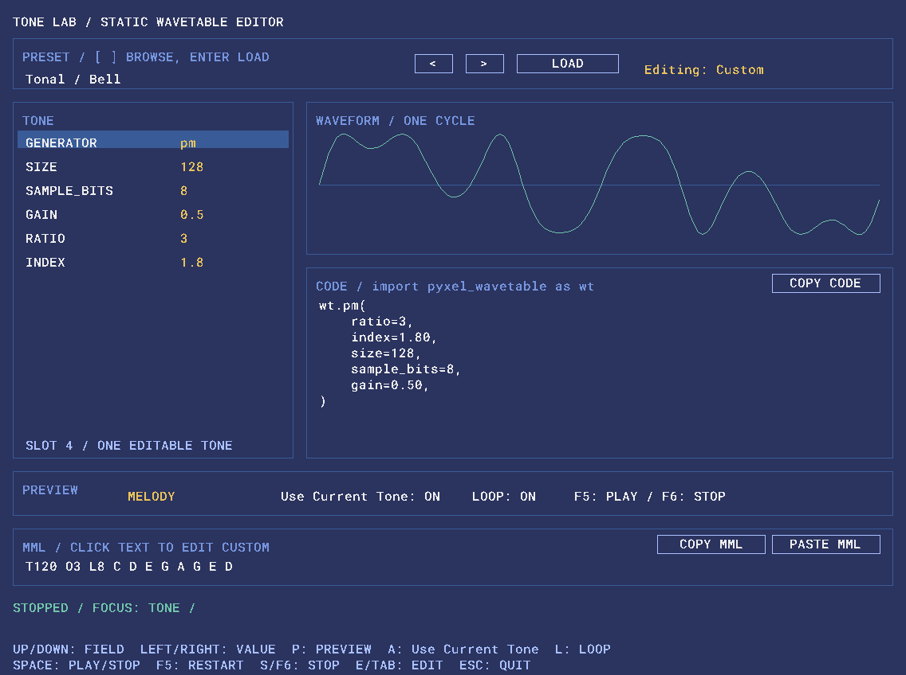
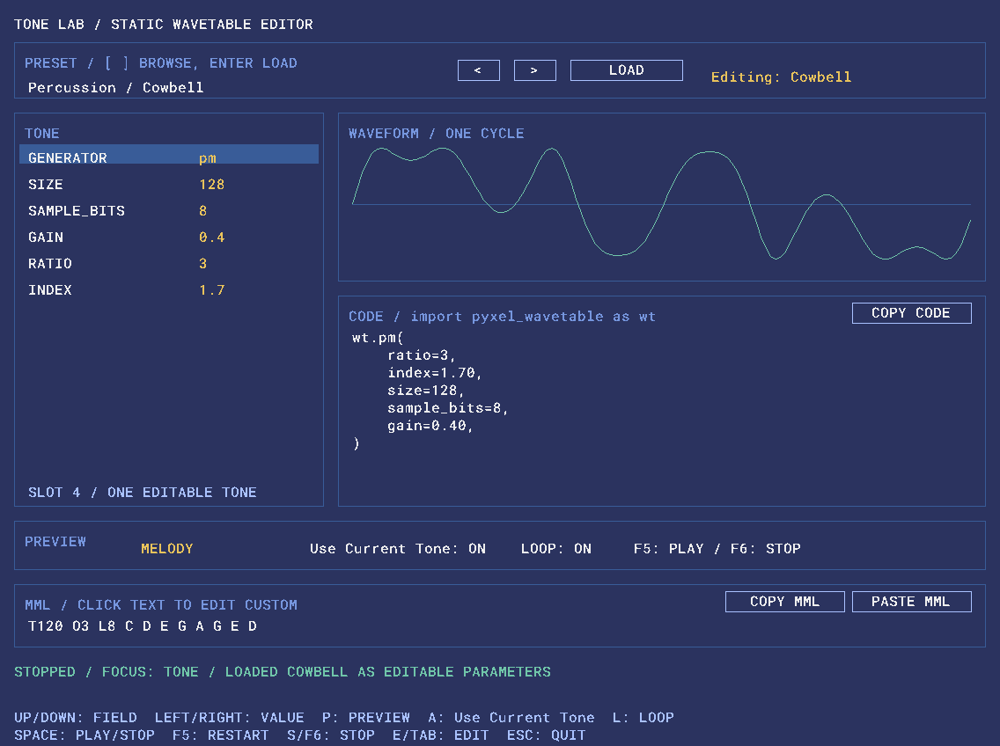
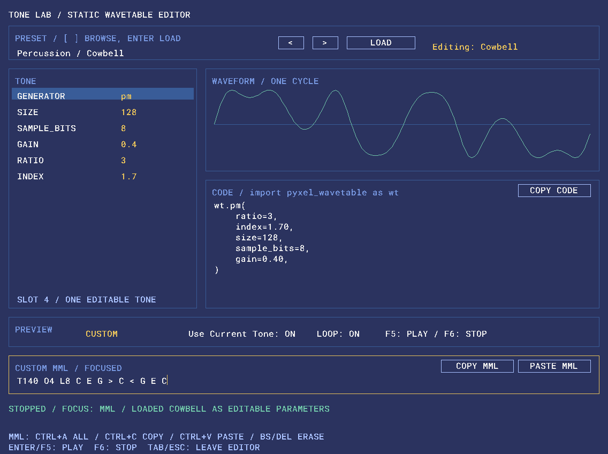
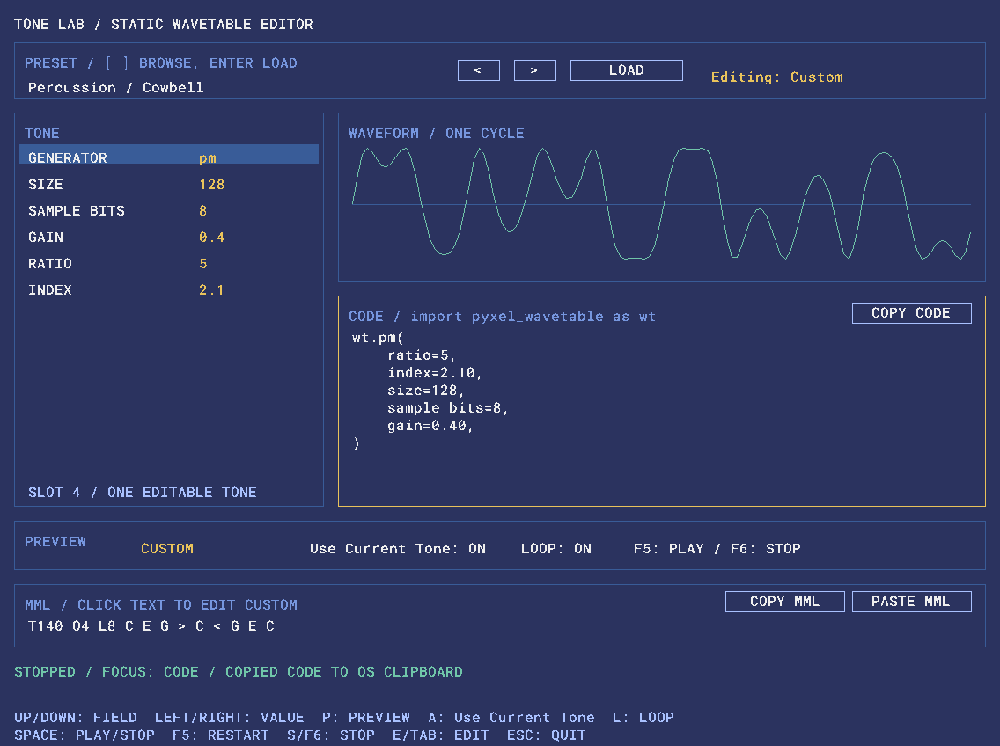

# Tone Lab Manual

Tone Labは、`pyxel_wavetable` のgeneratorやPresetを対話的に調整し、その場でMMLを使って試聴するためのサンプルです。

```sh
python examples/tone_lab.py
```

Tone Labはライブラリ本体のAPIではなく、`examples/tone_lab.py` に実装された音作り用UIです。

## 画面構成

Tone Labは主に次の領域で構成されています。



1. **PRESET** — Presetの選択と読込
2. **TONE** — generatorとパラメータの編集
3. **WAVEFORM** — 現在の1周期wavetable表示
4. **CODE** — 現在設定に対応するPythonコード
5. **PREVIEW** — 試聴パターン、Use Current Tone、Loop
6. **MML** — CUSTOM MMLの入力・Copy/Paste
7. **STATUS** — 再生状態、フォーカス、エラー表示

## Presetから音作りを始める

PRESET欄では `presets.py` に定義された全10種を選択できます。

### Tonal

- Bell
- Bass
- Lead
- Organ
- Soft

### Percussion

- Tom
- Woodblock
- Cowbell
- Metallic
- Click

`<` / `>` ボタン、または `[` / `]` キーでPresetを選択し、LOADまたはEnterで読み込みます。

Presetは固定の再生モードではありません。LOADするとgeneratorとパラメータへ展開され、その後は自由に変更できます。

例えばCowbellをLOADすると、PMの編集パラメータへ展開されます。画像では `Editing: Cowbell` と、対応する波形・`wt.pm(...)` の生成コードを確認できます。



```text
Generator: PM
ratio: 3
index: 1.7
gain: 0.40
```

パラメータを変更すると表示は `Editing: Custom` になります。同じPresetを再度LOADすれば元の値へ戻せます。

MML、Preview、Loop、Use Current Toneだけを変更してもPresetはCustomにはなりません。

## Toneを編集する

対応generator:

- PM
- Harmonics
- Pulse
- Sine
- Saw
- Triangle
- Square

共通パラメータ:

| Parameter | Tone Lab range |
| --- | --- |
| size | 32 / 64 / 128 / 256 / 512 |
| sample_bits | 1〜16 |
| gain | 0〜1、0.05刻み |

### PM

編集項目:

```text
ratio: 1〜16
index: 0〜10、0.1刻み
```

### Harmonics

H1〜H8をそれぞれ0〜1、0.05刻みで編集できます。

短いPresetの倍音配列をLOADした場合は、不足分を0で補って8項目として表示します。

### Pulse

`duty` を1/32〜31/32の範囲で調整できます。

## Waveform

WAVEFORM欄には、現在のToneの1周期wavetableを表示します。

表示は `sample_bits` の整数レンジを振幅へ換算したもので、`gain` 適用前の波形形状です。

パラメータ変更時には同じ編集用Toneスロットを更新します。操作のたびに `pyxel.tones` へ新しいToneを追加しません。

## Preview

既定Preview:

```text
melody
bass
short
perc_low
perc_high
custom
```

Pキーで切り替えます。

再生中に切り替えると、新しいPreviewを先頭から再生します。停止中は選択だけ変更します。

### melody

通常のメロディで音色を確認します。

```text
T120 O3 L8 C D E G A G E D
```

### bass

低音域での聞こえ方を確認します。

```text
T110 O2 L8 C C G G A G E C
```

### short

短い発音を確認します。

```text
T120 O4 L16 C R C R C R C R
```

### perc_low / perc_high

既存のPyxel MML Envelopeを使った、パーカッション確認用Previewです。

`perc_low` は低音域、`perc_high` は高音域を中心に確認するためのパターンです。

## Use Current Tone

`Use Current Tone: ON` の場合、再生時に現在編集中のTone indexをMML先頭へ自動的に付加します。

例:

```text
入力:
T120 O3 L8 C D E G

実際の再生:
@4 T120 O3 L8 C D E G
```

CUSTOM MML内に別の `@n` が書かれている場合は、その位置から通常のPyxel Tone切替が有効です。

OFFの場合はMMLを変更せず、そのままPyxelへ渡します。

AキーでON/OFFを切り替えます。

## CUSTOM MML

CUSTOMを選ぶと任意のMMLを入力できます。



画像は `T140 O4 L8 C E G > C < G E C` を入力した状態です。黄色い枠とカーソルが入力先を示し、STATUSには `FOCUS: MML` が表示されます。

編集開始:

```text
E
TAB
MML本文をクリック
```

編集時の主な操作:

| Operation | Key |
| --- | --- |
| カーソル移動 | ← / → |
| 行頭 / 行末 | HOME / END |
| 削除 | Backspace / Delete |
| 全選択 | Ctrl+A |
| Copy | Ctrl+C |
| Paste | Ctrl+V |
| 再生 | Enter / F5 |
| 停止 | F6 |
| 編集終了 | TAB / ESC |

MML欄は1行エディターです。長いMMLはカーソル位置に合わせて横スクロールします。

入力イベントに改行やタブが含まれる場合は空白へ変換します。

### Copy / Paste buttons

MML欄には次のボタンがあります。

- COPY MML
- PASTE MML

CODE欄には:

- COPY CODE

があります。

COPY MMLは現在表示中のMML全文、COPY CODEは生成コード全文をOSクリップボードへコピーします。PASTE MMLは編集中ならカーソル位置へ挿入し、Ctrl+Aで全選択していれば置換します。未編集のPreviewから押すとCUSTOMへ切り替え、貼り付けた内容を設定します。

Copy/PasteにはPythonの `tkinter` とデスクトップ環境が必要です。Pythonの配布方法によってはTkが別途必要になります。ライブラリ本体は `tkinter` に依存しません。コピー内容はTone Labを開いたまま別アプリへ貼り付けてください。

Tkが利用できない環境やClipboardへアクセスできない環境では `CLIPBOARD ERROR` を表示し、現在のMMLは保持します。

## Generated code

CODE欄には、現在の編集状態をgenerator呼び出しとして表示します。

PresetをLOADした場合でも、Preset関数ではなく展開後のgenerator設定を表示します。



画像はCowbellからratioとindexを変更し、COPY CODEを押した状態です。`Editing: Custom` となり、CODE欄の枠とSTATUSの `COPIED CODE TO OS CLIPBOARD` で操作対象と結果を確認できます。表示されているコードは次のとおりです。

```python
wt.pm(
    ratio=5,
    index=2.10,
    size=128,
    sample_bits=8,
    gain=0.40,
)
```

Harmonicsの例:

```python
wt.harmonics(
    [1.00, 0.40, 0.15, 0.00,
     0.00, 0.00, 0.00, 0.00],
    size=128,
    sample_bits=8,
    gain=0.50,
)
```

音を調整し、CUSTOM MMLで実際のフレーズを試してから、COPY CODEで自分のPyxelアプリへ持ち帰る使い方を想定しています。

## Playback

MML編集中でない場合:

| Operation | Key |
| --- | --- |
| Play / Stop toggle | SPACE |
| 先頭からPlay | F5 |
| Stop | S / F6 |
| Preview切替 | P |
| Use Current Tone | A |
| Loop | L |
| Tone項目選択 | ↑ / ↓ |
| 値変更 | ← / → |
| Preset選択 | [ / ] |
| Preset LOAD | Enter |
| MML編集 | E / TAB |
| Quit | ESC |

MML編集中は文字キーとSPACEを入力用に使うため、通常のショートカットにはなりません。

## Error handling

CUSTOM MMLは編集中に構文エラーになることがあります。

Tone LabはMML再生時の例外で終了せず、STATUS欄に `MML ERROR` を表示します。

入力内容は保持されるので、そのまま修正して再生できます。正常に再生できた時点でエラー表示をクリアします。

空のCUSTOM MMLもエラーとして扱います。

## Tone slot behavior

Tone Labは編集用Toneを1つだけ使います。Preset切替やパラメータ変更のたびにTone indexが増えることはありません。内部の更新方式は [Design](design.md) を参照してください。

## Scope

Tone Labは次の機能を実装しません。

- 独自MMLパーサ
- 独自シーケンサ
- Note On/Off管理
- 動的PM Envelope
- 毎フレームのwavetable変調
- 独自Sound / Music

MMLの解析、タイミング、再生はPyxelへ任せます。

## Related documentation

- [README](../README.md)
- [Design](design.md)
- [Pyxel API Reference](https://kitao.github.io/pyxel/web/api-reference/)
